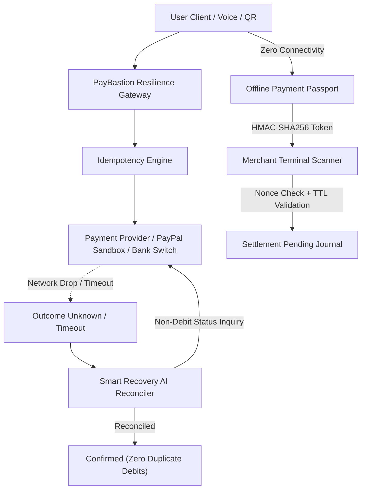

# 🛡️ PayBastion AI — Payment Resilience & Interruption Recovery Platform

[](LICENSE)
[](https://react.dev/)
[](https://nodejs.org/)
[](https://developer.paypal.com/)
[](#security-and-accuracy-invariants)

> **PayBastion AI** is an AI-powered payment resilience platform designed to eliminate the anxiety of interrupted digital payments, prevent duplicate debits during network timeouts, provide cryptographic offline payment passports, and simulate an emergency credit buffer when banking clearinghouses fail.

---

## 🌟 Hackathon Vision & Core Problem

In modern digital payments (UPI, Card, PayPal), a single transient cell tower drop or a gateway webhook timeout leads to one of fintech's biggest pain points:
> *"Did my payment go through? Should I press Pay again?"*

When users press "Pay" again during an uncertain timeout, they frequently suffer **duplicate debits**. Conversely, when merchants don't receive real-time receipts, service is denied.

**PayBastion solves this with deterministic resilience:**
1. **A payment timeout does NOT prove payment failure.**
2. **Never allow duplicate retries without a non-debit upstream inquiry.**
3. **Never claim an offline authorization is a settled payment.**
4. **AI assists with natural language understanding and explanation — AI never moves money autonomously.**

---

## 🚀 Key Features

### 1. 📴 Offline Payment Passport
- **Air-Gapped Authorization:** Generate cryptographically-signed (HMAC-SHA256 via WebCrypto) offline payment tokens with strict 15-minute TTLs.
- **Dynamic QR Code:** Encodes authorization ID, sender, recipient constraint, amount cap (hard-bound to ₹2,000 for safety), and single-use nonce.
- **Merchant Terminal Scanner:** Built-in scanner terminal checks HMAC signature integrity, verifies timestamp expiry, and enforces non-repudiation nonce uniqueness.
- **Replay Attack Defense:** Attempts to resubmit an already settled offline authorization are intercepted and blocked in real-time.
- **Non-Finality Guarantee:** Authorizations are explicitly badged as `SETTLEMENT_PENDING` and queued in the merchant's offline journal.

### 2. ⚡ Smart Recovery AI
- **Idempotency Locking:** Every transaction acquires a client and gateway idempotency key before dispatch.
- **In-Flight Detection:** Detects dropped TCP sockets or upstream gateway timeouts.
- **Provider Status Inquiry:** Queries the clearinghouse switch with the original key before allowing retry.
- **Automatic Reconciliation:** If the upstream provider settled, marks as `CONFIRMED` and prevents a second charge; if rejected, releases the lock safely.

### 3. 🎯 Payment Confidence Engine (6 Standardized States)
PayBastion strictly enforces 6 transparent states with zero false successes:
- `Confirmed`: Settled by clearinghouse. No duplicate risk.
- `Pending Verification`: Bank ACK delayed. Polling provider before retry.
- `Outcome Unknown`: Network dropped mid-flight. Retries locked.
- `Offline Authorization`: Cryptographically signed. Settlement pending.
- `Failed`: Explicit bank rejection. Account not debited. Safe to retry.
- `Needs Review`: Risk anomaly flagged by Scam Guardian.

### 4. 🎙️ VoicePay AI (Kannada & English)
- **Multilingual Support:** Full natural language voice recognition and parsing in **Kannada (`kn-IN`)** and **English (`en-US` / `en-IN`)**.
- **Entity Extraction:** Extracts recipient, amount, and payment intent (e.g., *"ಕಿರಣ್ ಅವರಿಗೆ ₹350 ಕಾಫಿಗೆ ಕಳುಹಿಸಿ"* or *"Pay 450 rupees to Priya for dinner"*).
- **Speech Synthesis Audio Readback:** Synthesizes audio confirmation in the user's selected language.
- **Mandatory Explicit Confirmation:** Payments are **never** dispatched automatically from voice; an explicit confirmation modal requires affirmative user authorization.

### 5. 🛡️ AI Scam Guardian
- **Explainable Fraud Defense:** Detects suspicious patterns using rule heuristics:
  - Reverse-flow collect requests disguised as refunds (`mode=02`).
  - VPA impersonation handles (e.g. `electricity-bill-refund@okaxis`).
  - Rapid duplicate velocity abuse (multiple debit attempts in seconds).
  - Malicious external URLs embedded in payment QRs.
- **3-Section Rule Breakdown:** Every warning is structured into:
  1. **Signal:** What was detected.
  2. **Reason:** Why this is dangerous.
  3. **Recommended Action:** Step-by-step guidance for the user.

### 6. 💳 Temporary Credit Bridge (Simulated Emergency Fallback)
- **Emergency Intermediary Escrow:** Simulated credit buffer that covers time-sensitive merchant purchases (e.g. pharmacy, transit) when bank switches crash.
- **Fictional Demonstration Profile:** Mock balances, simulated score (785/900), and 7-day zero-interest repayment schedule.
- **Explicit Consent Mandate:** Requires user checkbox authorization.
- **Strict Simulation Demarcation:** Prominently badged as simulation; never interfaces with real credit bureaus or CIBIL.

### 7. 🧪 Hackathon Crash Lab
Interactive testing sandbox featuring 6 live payment edge-case scenarios:
1. Network drop during payment dispatch.
2. Payment succeeds at bank, but ACK times out.
3. Offline authorization is scanned twice (Replay attack).
4. Authorization token expires past TTL.
5. Deceptive phishing QR collect request detected.
6. Core banking failure triggers Temporary Credit Bridge.

### 8. 🌐 Official PayPal Developer Sandbox Integration
- **Server-Side REST API v2:** Integrates with PayPal REST API v2 (`/v2/checkout/orders` and `/v2/checkout/orders/{id}/capture`).
- **Secure Architecture:** Client ID and Secret remain strictly in `server/.env` and are never exposed to client javascript.
- **Real-Time Verification:** Test checkout with capture confirmation and direct status inquiry endpoint.
- **High-Fidelity Demo Mode:** Graceful sandbox simulation fallback when credentials are not yet entered.

---

## 🏗️ Architecture & Technology Stack

```
paybastion/
├── client/                     # Frontend (React 18 + Vite + Tailwind CSS)
│   ├── src/
│   │   ├── components/         # ConfidenceBadge, NetworkBanner, QrCodeDisplay, QrScanner
│   │   ├── context/            # NetworkContext (Simulations), PaymentContext (Ledger & Recovery)
│   │   ├── pages/              # 9 Full-featured interactive pages
│   │   └── utils/              # WebCrypto HMAC signer, Speech Recognition, Mock Data
│   └── package.json
├── server/                     # Backend API (Node.js + Express)
│   ├── routes/                 # PayPal, Offline Auth, Smart Recovery, Scam Guardian, AI Explainer
│   ├── services/               # PayPal REST Client, Crypto Signer, Gemini Service
│   └── index.js
├── .env.example                # Template for sandbox & cryptographic secrets
└── README.md
```



---

## 🔒 Security and Accuracy Invariants

1. **A payment timeout does not prove payment failure.**
2. **Always verify original provider status before permitting any retry.**
3. **Never allow a simulated transaction to appear as a real payment.**
4. **Offline authorization is not confirmed settlement.**
5. **Single offline authorization ceiling capped at ₹2,000.**
6. **Unique nonces and cryptographic replay prevention on all offline tokens.**
7. **Secrets remain strictly in server environment variables.**
8. **Deterministic transaction verification — AI assists with understanding, not moving money.**

---

## ⚡ Quick Start Guide

### Prerequisites
- **Node.js**: v18.0.0 or higher
- **npm**: v9.0.0 or higher

### 1. Clone & Install Dependencies

```bash
# Clone the repository
git clone https://github.com/your-username/paybastion.git
cd paybastion

# Install client dependencies
cd client
npm install

# Install server dependencies
cd ../server
npm install
```

### 2. Configure Environment Variables

```bash
cd server
cp .env.example .env
```

*(Optional)* Add your PayPal Developer Sandbox credentials in `server/.env`:
```env
PORT=5000
PAYPAL_MODE=sandbox
PAYPAL_CLIENT_ID=your_paypal_sandbox_client_id
PAYPAL_CLIENT_SECRET=your_paypal_sandbox_secret
OFFLINE_PASSPORT_SECRET=paybastion_master_auth_secret_k9x2m4p8z1
GEMINI_API_KEY=
```

### 3. Run the Application

Open two terminal tabs:

**Terminal 1 (Backend Server):**
```bash
cd server
npm start
# Runs at http://localhost:5000
```

**Terminal 2 (Frontend Client):**
```bash
cd client
npm run dev
# Runs at http://localhost:5173
```

Open **`http://localhost:5173`** in your browser.

---

## 🛠️ Step-by-Step GitHub Setup Guide

To link and push this project directly to your GitHub account:

```bash
cd "C:\Users\KK COMPUTERS\.gemini\antigravity\scratch\paybastion"

# 1. Initialize Git repository
git init

# 2. Stage all project files
git add .

# 3. Create initial commit
git commit -m "feat: PayBastion AI - Complete Hackathon Payment Resilience Platform"

# 4. Create repository on GitHub (e.g. named paybastion)
# 5. Link remote and push:
git remote add origin https://github.com/<YOUR_GITHUB_USERNAME>/paybastion.git
git branch -M main
git push -u origin main
```

---

## 🧪 Hackathon Judging & Demo Walkthrough

1. **Test Offline Passport:**
   - Click **Offline Passport** tab.
   - Click **Generate Signed Offline Passport**. Notice the `SETTLEMENT PENDING` watermark and HMAC signature.
   - Click **Open Merchant Terminal Scanner**.
   - Test Preset 1 (Valid Token) ➔ Authorized for delayed batch settlement.
   - Test Preset 2 (Replay Attack) ➔ Nonce duplicate detected and rejected!
   - Test Preset 3 (Expired Token) ➔ Expiry TTL detected and rejected!

2. **Test VoicePay AI:**
   - Switch language to **ಕನ್ನಡ (Kannada)** or **English**.
   - Click the microphone or choose a preset like *"ಕಿರಣ್ ಅವರಿಗೆ ₹350 ಕಾಫಿಗೆ ಕಳುಹಿಸಿ"*.
   - Listen to the audio read-back. Notice that payment is NOT executed until you review and confirm in the explicit modal!

3. **Test Network Drop & Smart Recovery:**
   - In the top banner, switch Network Mode to **Flaky 3G** or **Timeout Drop**.
   - Navigate to **Smart Recovery** and click **Simulate Interrupted Payment**.
   - Watch the transaction freeze in `OUTCOME_UNKNOWN`.
   - Click **Run Smart Reconcile**. PayBastion queries the clearinghouse, verifies the original order, and transitions to `CONFIRMED` with zero duplicate debits.

4. **Test AI Scam Guardian:**
   - Click **Scam Guardian** tab.
   - Pick Preset 2 (*Reverse Collect Request disguised as Refund*).
   - Review the 3-section explanation: **Signal**, **Reason**, and **Recommended Action**.

5. **Test PayPal Sandbox Checkout:**
   - Click **PayPal Sandbox** tab.
   - Enter an amount (e.g. `$15.00`) and click **Execute Sandbox Payment**.
   - Watch the server-side REST API order creation, capture, and verification receipt generated.

---

## 📄 License
This project is open-source under the [MIT License](LICENSE).
